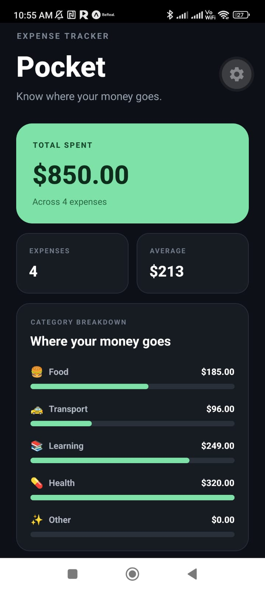
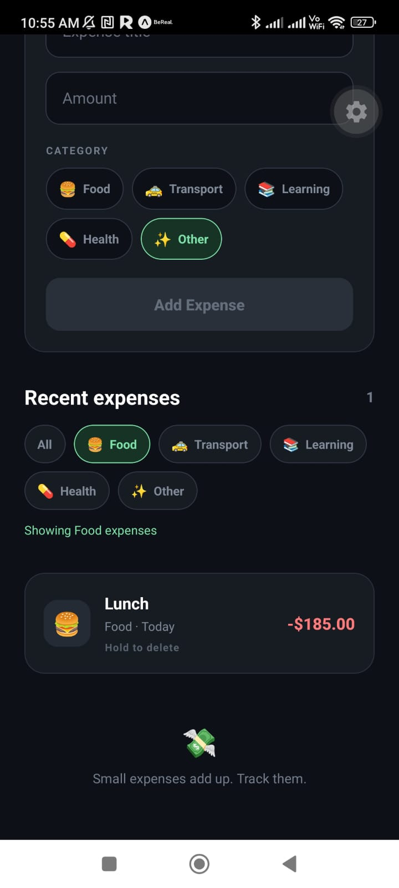

# Pocket

Pocket is a mobile expense tracker built with React Native, Expo and TypeScript.

It helps users record expenses, organize them by category and understand their spending through a simple dashboard and visual breakdown.

## Features

- Add expenses with title and amount
- Numeric amount validation
- Expense categories
- Category selection with interactive chips
- Dynamic total spent
- Average expense calculation
- Spending breakdown by category
- Dynamic comparison bars
- Filter expenses by category
- Empty states for filtered results
- Delete expenses with long press confirmation
- Responsive dashboard calculations
- Mobile keyboard handling
- Safe area support
- Efficient list rendering with FlatList

## Tech Stack

- React Native
- Expo
- React
- TypeScript
- react-native-safe-area-context

## Screenshots

### Dashboard



### Category Filter



## What I Practiced

Pocket is App 04 of my progressive React Native learning lab.

I practiced:

- `FlatList`
- Controlled `TextInput`
- Numeric form input
- String-to-number conversion
- Form validation
- Typed categories with TypeScript unions
- Reusable selectable chips
- `Pressable`
- Derived state
- `reduce()`
- `filter()`
- `find()`
- `Math.max()`
- Dynamic styles
- Percentage-based visual bars
- Native `Alert`
- `onLongPress`
- Empty states
- Keyboard handling
- Safe areas

## Data and Derived State

Pocket keeps the expense collection as the main source of truth.

Values such as total spending, averages, category totals and filtered expenses are derived from that state instead of being stored separately.

```text
expenses
   |
   +--> totalSpent
   +--> averageExpense
   +--> categoryTotals
   +--> maxCategoryTotal
   +--> filteredExpenses
```

This keeps the UI synchronized whenever an expense is created or deleted.

## Category Breakdown

Category totals are generated from the expense collection using `reduce()`.

```ts
const categoryTotals = expenses.reduce<
  Record<ExpenseCategory, number>
>(
  (totals, expense) => ({
    ...totals,
    [expense.category]:
      totals[expense.category] + expense.amount,
  }),
  {
    Food: 0,
    Transport: 0,
    Learning: 0,
    Health: 0,
    Other: 0,
  },
);
```

The largest category is used as the visual reference for the category bars.

## Array Patterns Practiced

```text
Add item       -> spread
Delete item    -> filter()
Filter data    -> filter()
Find one item  -> find()
Update item    -> map()
Aggregate data -> reduce()
Find maximum   -> Math.max()
```

## React Web vs React Native

Concepts reused from React:

- Components
- Props
- `useState`
- Controlled inputs
- Derived values
- Immutable updates
- Conditional rendering
- Array transformations
- TypeScript

React Native concepts practiced:

- `FlatList`
- `TextInput`
- `Pressable`
- `onPress`
- `onLongPress`
- `keyboardType`
- `KeyboardAvoidingView`
- `Keyboard.dismiss()`
- Native `Alert`
- Safe areas
- Mobile-first interactions

## Run Locally

Requirements:

- Node.js 22.19.0
- npm
- Expo Go or an Android development environment

Install dependencies:

```bash
npm install
```

Check Expo-compatible dependency versions:

```bash
npx expo install --check
```

Start the development server:

```bash
npx expo start
```

## Validation

The project was validated with:

```bash
npx tsc --noEmit
npx expo install --check
npx expo-doctor@latest
```

Expo Doctor result:

```text
21/21 checks passed. No issues detected!
```

## About the Lab

Pocket is App 04 of a progressive React Native lab focused on building practical mobile development skills through increasingly complete applications.

The main focus of this project was forms, numeric data, typed categories, derived financial calculations, filtering and data visualization.
